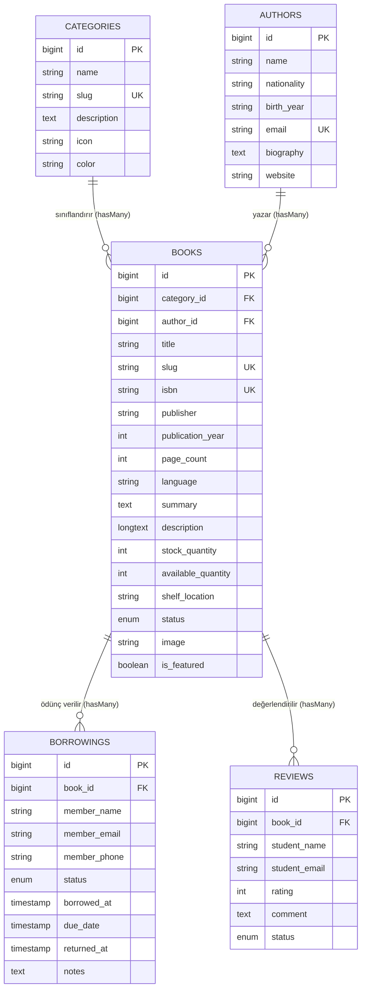

# BiblioTech - Kütüphane & E-Kitap Yönetim Portalı
> **Gazi Üniversitesi / Bilgisayar ve Öğretim Teknolojileri Eğitimi (BTÖ)**  
> **BTÖ - 303 Web Tabanlı Programlama Dersi Ara Uygulama Projesi**

---

## 🎯 1. Proje Özeti ve Konsepti

**BiblioTech**, modern web mimarileri ve akademik yazılım geliştirme standartlarına uygun olarak tasarlanmış **Kütüphane ve E-Kitap Yönetim Portalı**dır. Proje; kütüphane kitap envanterinin, yazar kadrosunun, edebi/akademik tür kategorilerinin, okur ödünç alma & iade sirkülasyonunun ve okur değerlendirme/puanlama sisteminin uçtan uca yönetilmesini sağlayan tam kapsamlı bir **Laravel CRUD (Create, Read, Update, Delete)** uygulamasıdır.

Hantal üçüncü parti CSS kütüphaneleri (Tailwind/Bootstrap) yerine, modern cam efekti (**glassmorphism**), dinamik karanlık/aydınlık mod (**Dark/Light Mode**), özel tasarım token'ları ve mikro-animasyonlar barındıran **hafif ve yüksek performanslı Vanilla CSS** mimarisi kullanılmıştır.

---

## 🛠️ 2. Teknoloji Yığını ve Gereksinimler

- **Framework:** Laravel 11 / 12 (PHP MVC Framework)
- **Programlama Dili:** PHP 8.3+
- **Veritabanı & ORM:** SQLite / MySQL desteği, Eloquent ORM
- **Tasarım & Ön Yüz:** Semantic HTML5, Pure Vanilla CSS (CSS Custom Properties), Blade Templating, Vanilla JavaScript
- **Test Çatısı:** PHPUnit (Otomasyonel Feature & CRUD Testleri - 14/14 Başarılı)
- **Kod Standartları:** Laravel Pint (PSR-12 Kod Biçimlendirme)

---

## 🏗️ 3. Veritabanı Mimarisi ve Eloquent İlişkileri

Sistemde ilişkisel veritabanı kurallarına tam uyumlu 5 ana model ve tablolar arası **1-to-Many (Bire-Çok)** ilişkiler kurulmuştur:



### Eloquent İlişki Tanımları:
1. `Category` (1) ➔ `Book` (N): Bir kategori altında birden çok kitap bulunabilir.
2. `Author` (1) ➔ `Book` (N): Bir yazarın birden fazla eseri kütüphanede kayıtlı olabilir.
3. `Book` (1) ➔ `Borrowing` (N): Bir kitap okurlara defalarca ödünç verilebilir (raf ve stok takipli).
4. `Book` (1) ➔ `Review` (N): Bir kitap için birden çok okur puan ve değerlendirme yapabilir.

---

## ⚡ 4. Temel Özellikler ve CRUD Fonksiyonları

### A. Kitap Kataloğu Yönetimi (Ana CRUD Modülü)
- **Listeleme (Read / Index):** Kitap kartları, kapak görseli, tür rozeti, yazar bilgisi, sayfa sayısı, raf konumu ve yıldızlı okur puanı.
- **Canlı Filtreleme & Arama:** Metin araması (`search`), Kategori filtresi, Yazar filtresi, Durum filtresi (`available`, `borrowed`, `maintenance`) ve Sıralama (`En Yeni`, `En Popüler / Çok Ödünç Alınan`, `Sayfa Sayısı`, `Basım Yılı`, `Müsait Stok`).
- **Özel Sayfalama (Pagination):** Arama ve filtre parametrelerini koruyan URL query string entegrasyonlu Blade paginator.
- **Detay Görünümü (Show):** Kitap özellikleri, yazar kartı, hızlı ödünç verme formu, geçmiş ödünç hareketleri tablosu ve okur incelemeleri.
- **Yeni Kitap Ekleme (Create / Store):** Form validasyonu (`StoreBookRequest`), canlı görsel önizleme, slug üretimi, dosya yükleme (`Storage::disk('public')`).
- **Kitap Düzenleme (Edit / Update):** Mevcut verilerle ön yükleme, mevcut görseli koruma veya yenisiyle değiştirme.
- **Kitap Silme (Destroy):** Güvenli onay modalı ve diskteki görsel dosyasının otomatik temizlenmesi (`cascade delete`).

### B. Ödünç & İade Sirkülasyon Masası (Borrowing Management)
- **Stok Denetimli Ödünç Verme:** Kitabın raftaki müsait adedi kontrol edilir. Stok bittiğinde ödünç verme formu kilitlenir.
- **15 Günlük İade Süresi:** Otomatik `due_date` hesaplaması.
- **Tek Tıkla İade Alma:** Okur kitabı getirdiğinde tek tıkla kütüphane rafına geri eklenir (`available_quantity` artar).
- **Filtreleme:** Aktif ödünçteki kitaplar, iade edilenler ve süresi gecikenler ayrıştırılabilir.

### C. Kategori & Yazar Yönetimi
- **Kategoriler:** Renk kodlu etiketler, kitap sayısı göstergesi ve ilişki korumalı silme (bağlı kitabı olan kategori silinemez).
- **Yazarlar:** Yazar biyografileri, uyruk, doğum yılları, iletişim bilgileri ve yazarın kütüphanedeki tüm kitaplarının listesi.

### D. Okur Değerlendirme & Puanlama (Review & Rating) Sistemi
- **1-5 Yıldız Puanlama:** Kitap detay sayfası üzerinden okur yorumu ve yıldız puanı girişi.
- **Dinamik Ortalama:** Eloquent `averageRating` accessor'ı ile 5.0 üzerinden anlık ortalama hesabı.
- **Yorum Moderasyonu:** Uygunsuz yorumların silinmesi.

### E. Rotalama (Routing) Mimarisi & Canlı Değerlendirme Sayfası (`/route-evaluation`)
- **Canlı Rota Denetim Paneli:** Navbar üzerindeki "Rota Değerlendirmesi" bağlantısıyla sistemdeki tüm RESTful rotaların, parametre kısıtlamalarının (`whereNumber`), Controller eşleşmelerinin ve CRUD görevlerinin dökümü.
- **Parametre Kısıtlamaları (Route Constraints):** Sayısal ID parametreleri için regex kısıtlaması uygulanarak geçersiz URL denemeleri engellenmiştir (`whereNumber('book')`, `whereNumber('author')`).
- **Fallback Güvenliği:** Eşleşmeyen tüm geçersiz istekler `Route::fallback()` mekanizmasıyla yakalanıp kullanıcı dostu bir bildirimle ana panele yönlendirilir.

### F. Tasarım & Kullanıcı Deneyimi (UX)
- **Karanlık / Aydınlık Mod (Dark/Light Mode):** `localStorage` hafızalı ve sistem tercihini otomatik algılayan tema motoru.
- **Flash Bildirimleri:** Başarı, Hata ve Doğrulama bildirimlerinin otomatik kapanan modern toast kutuları.
- **Responsive Tasarım:** Masaüstü, tablet ve mobil cihazlarla tam uyumlu esnek CSS Grid ve Flexbox yapısı.

---

## 🚀 5. Kurulum ve Çalıştırma Adımları

Projeyi yerel ortamınızda çalıştırmak için:

### 1. Bağımlılıkları Yükleme
```bash
composer install
```

### 2. Ortam Değişkenleri ve Anahtar Üretimi
```bash
cp .env.example .env
php artisan key:generate
```

### 3. Veritabanını Oluşturma ve Hazır Verileri Yükleme (Seed)
```bash
php artisan migrate:fresh --seed
```

### 4. Dosya Yüklemeleri için Sembolik Bağ Kurma
```bash
php artisan storage:link
```

### 5. Yerel Sunucuyu Başlatma
```bash
php artisan serve
```
*veya proje kök dizinindeki `start-server.bat` dosyasına çift tıklayabilirsiniz.*

Uygulamaya tarayıcınızdan erişin:
👉 **http://127.0.0.1:8000**

---

## 🧪 6. Otomatik Testleri Çalıştırma

Projede tüm CRUD fonksiyonları ve senaryoları PHPUnit ile test edilmiştir:

```bash
php artisan test
```

**Test Sonuçları (14 Test, 32 İddia - %100 Başarılı):**
- ✅ `test_dashboard_loads_successfully` (Kontrol paneli metrikleri testi)
- ✅ `test_books_index_page_displays_books` (Kitap kataloğu ve filtreleme testi)
- ✅ `test_book_create_page_loads` (Kitap oluşturma formu testi)
- ✅ `test_can_store_new_book` (Kitap kaydetme ve validasyon testi)
- ✅ `test_book_detail_page_loads` (Kitap detay ve ödünç sayfası testi)
- ✅ `test_book_can_be_updated` (Kitap güncelleme testi)
- ✅ `test_book_can_be_deleted` (Kitap silme ve temizlik testi)
- ✅ `test_member_can_borrow_book_and_decrement_stock` (Ödünç alma ve stok düşürme testi)
- ✅ `test_borrowed_book_can_be_returned_and_restock` (İade alma ve stoka geri ekleme testi)
- ✅ `test_reader_can_review_and_rate_book` (Okur puanlama ve yorum testi)
- ✅ `test_route_evaluation_page_loads_successfully` (Rota değerlendirme paneli testi)
- ✅ `test_invalid_route_fallback_redirects_to_dashboard` (Geçersiz URL fallback yönlendirme testi)

---

## 📁 7. Proje Dosya Dizini

```
12.10/
├── app/
│   ├── Http/
│   │   ├── Controllers/
│   │   │   ├── DashboardController.php        # Canlı kütüphane metrikleri
│   │   │   ├── BookController.php             # Kitap Resource CRUD
│   │   │   ├── AuthorController.php           # Yazar profilleri ve eserleri
│   │   │   ├── CategoryController.php         # Edebi türler ve kategoriler
│   │   │   ├── BorrowingController.php        # Ödünç alma & iade sirkülasyonu
│   │   │   ├── ReviewController.php           # Okur puanlama ve incelemeleri
│   │   │   └── RouteEvaluationController.php  # Canlı rota mimarisi denetimi
│   │   └── Requests/
│   │       ├── StoreBookRequest.php           # Kitap kayıt doğrulama
│   │       └── UpdateBookRequest.php          # Kitap güncelleme doğrulama
│   └── Models/
│       ├── Book.php                           # Kitap modeli & ilişkileri
│       ├── Author.php                         # Yazar modeli
│       ├── Category.php                       # Kategori modeli
│       ├── Borrowing.php                      # Ödünç hareket modeli
│       └── Review.php                         # Okur yorum modeli
├── database/
│   ├── migrations/                            # Veritabanı tabloları
│   └── seeders/                               # Zengin kütüphane başlangıç verileri
├── public/
│   ├── css/app.css                            # Özel Vanilla CSS Tasarım Sistemi
│   ├── js/app.js                              # Tema motoru & etkileşimli JS
│   └── images/placeholders/                   # Kitap SVG kapak şablonu
├── resources/views/
│   ├── layouts/app.blade.php                  # Ana Blade iskeleti
│   ├── dashboard.blade.php                    # Canlı kütüphane paneli
│   ├── books/                                 # index, create, edit, show
│   ├── authors/                               # index, show
│   ├── categories/                            # index
│   ├── borrowings/                            # index (Ödünç takip tablosu)
│   ├── routes/evaluation.blade.php            # Canlı rota değerlendirmesi
│   └── vendor/pagination/custom.blade.php     # Özel sayfalama bileşeni
├── tests/Feature/BookCrudTest.php             # 14 adet başarılı feature testi
├── start-server.bat                           # Tek tıkla sunucu başlatıcı
└── README.md                                  # Proje ve kurulum dokümanı
```

---
*Gazi Üniversitesi BTÖ-303 Web Tabanlı Programlama Ara Uygulaması için başarıyla hazırlanmıştır.*
